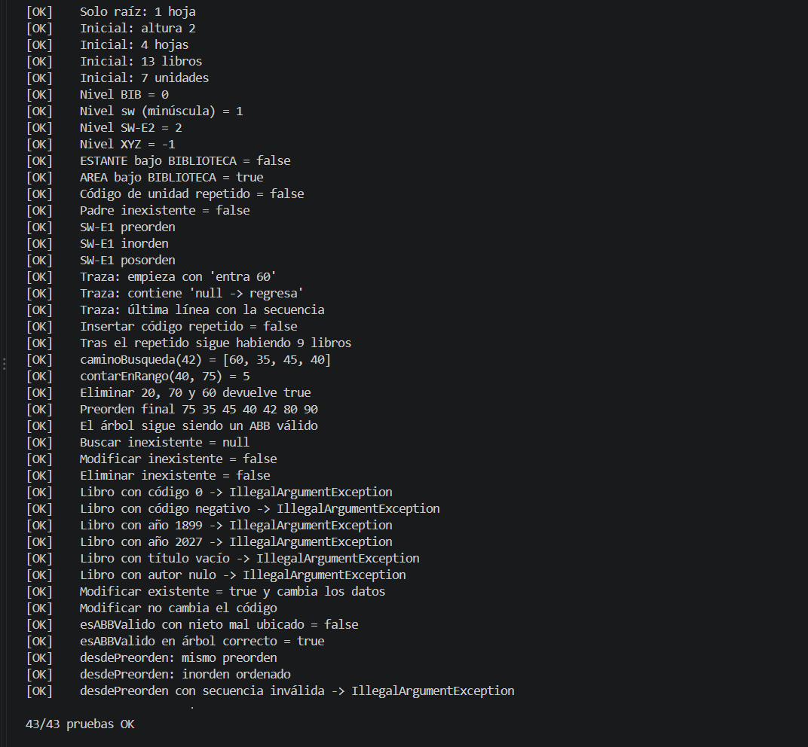

# Deber-Arboles-LlamucaAndres

Catálogo de la Biblioteca FISEI con árbol general y ABB en Java.

**APE 3 · Catálogo de la Biblioteca FISEI con árbol general y ABB en Java**
Universidad Técnica de Ambato - FISEI - Carrera de Software · Estructura de Datos · Tercer nivel

Autor: Andres LLamuca

## El problema

La Biblioteca FISEI se organiza en **Áreas** y cada Área en **Estantes**. Esa jerarquía se modela con un **árbol general n-ario**. Los libros de cada Estante se guardan en un **Árbol Binario de Búsqueda (ABB)** ordenado por el código del libro (entero positivo, sin repetidos).

```
BIB Biblioteca FISEI
├── SW Software
│   ├── SW-E1 Estante 1 de Software → 60, 35, 80, 20, 45, 70, 90, 40, 75
│   └── SW-E2 Estante 2 de Software → 15, 10, 25
├── TI Tecnologías de la Información
│   └── TI-E1 Estante 1 de TI → 50
└── TEL Telecomunicaciones
```

La biblioteca inicial tiene 7 unidades, 4 hojas, altura 2 (en aristas) y 13 libros.

## Estructura del proyecto

```
src/
├── enums/      TipoUnidad, TipoRecorrido
├── modelo/     Libro, UnidadBiblioteca
├── negocio/    NodoUnidad, NodoLibro, ArbolBiblioteca, CatalogoABB
└── app/        Main, DatosPrueba, PruebasBiblioteca
capturas/       evidencias de ejecución
TRAZAS.md       resolución a mano
```

### Clases principales

| Clase | Responsabilidad |
|-------|-----------------|
| `ArbolBiblioteca` | Árbol general: `agregar`, `buscar`, `altura`, `contarHojas`, `nivel`, `mostrarJerarquia`, `contarLibrosTotal` |
| `CatalogoABB` | ABB de libros: `insertar`, `buscar`, `contar`, `recorrer`, `trazaRecorrido`, `modificar`, `eliminar` (3 casos) |
| `CatalogoABB` (retos) | `contarEnRango` (con poda), `caminoBusqueda`, `esABBValido` (límites mín/máx), `desdePreorden` (extra) |
| `Libro` | Validaciones: código > 0 (sin setter), título y autor no vacíos, año 1900-2026 |
| `UnidadBiblioteca` | Código en mayúsculas, nombre y tipo |

Todas las operaciones de ambos árboles son **recursivas**. No se usan `TreeSet`, `TreeMap`, `PriorityQueue`, `NavigableSet/Map`, `Collections.sort` ni `List.sort`.

## Cómo ejecutar

Requisito: JDK 11 o superior.

Desde la raíz del proyecto:

```bash
javac -encoding UTF-8 -d out src/enums/*.java src/modelo/*.java src/negocio/*.java src/app/*.java
java -cp out app.Main                # menú interactivo
java -cp out app.PruebasBiblioteca   # pruebas automáticas
```

En Visual Studio Code: abre la carpeta del proyecto (`src` es la carpeta de fuentes) y ejecuta `Main.java` o `PruebasBiblioteca.java` con el botón *Run*.

## Menú interactivo

1. Cargar estructura inicial
2. Mostrar jerarquía
3. Agregar unidad
4. Buscar unidad
5. Consultar altura, hojas, nivel y total de libros
6. Insertar libro en un estante
7. Buscar libro en un estante
8. Modificar libro de un estante
9. Eliminar libro de un estante
10. Mostrar recorridos con su traza
11. Ejecutar retos
12. Ejecutar PruebasBiblioteca
0. Salir

## Pruebas

`PruebasBiblioteca` ejecuta los casos obligatorios del enunciado (raíz sola, estructura inicial, niveles, jerarquía inválida, recorridos de SW-E1, código repetido, `caminoBusqueda(42)`, `contarEnRango(40, 75)`, eliminaciones 20-70-60, inexistentes, datos inválidos, `esABBValido` con nieto mal ubicado y `desdePreorden`) y termina mostrando `X/N pruebas OK`.

Resultado esperado: **43/43 pruebas OK**.

### Captura de PruebasBiblioteca



## Trazas a mano

La resolución a mano (códigos personales, inserciones, recorridos, traza y eliminaciones con diagramas Mermaid) está en [TRAZAS.md](TRAZAS.md).
