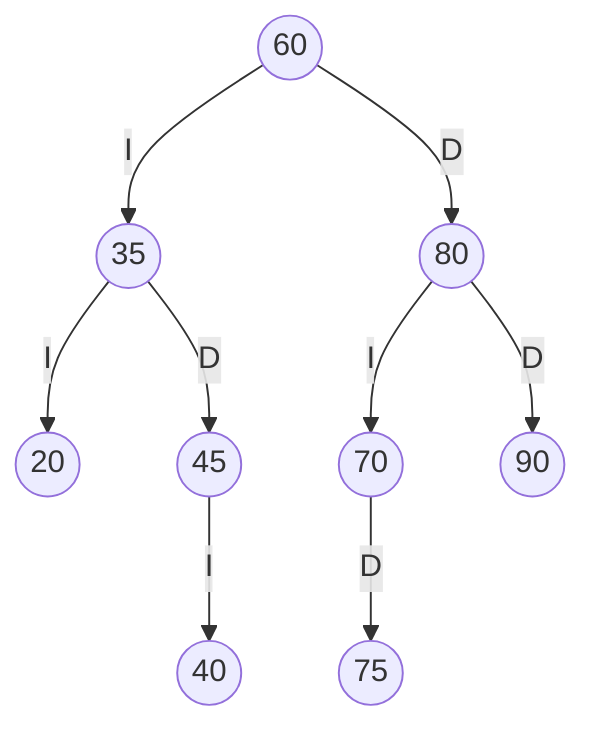
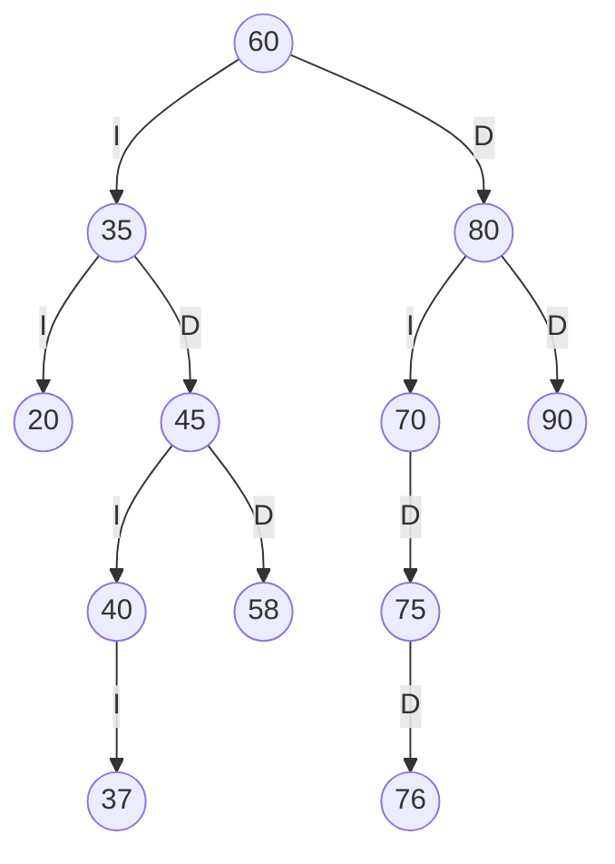
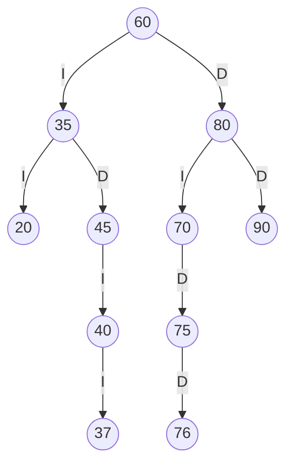
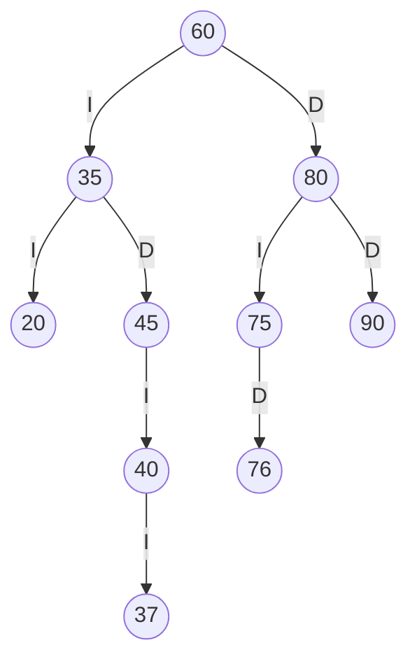
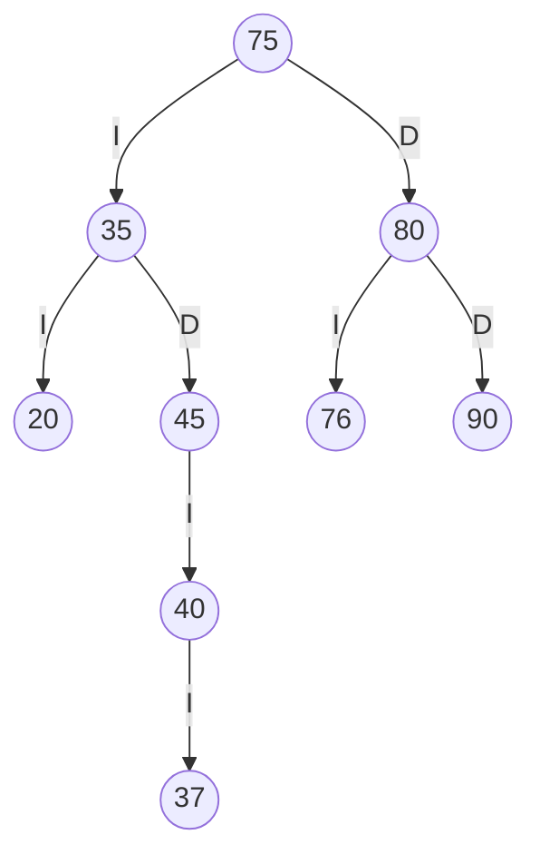

# TRAZAS.md - Resolución a mano

Estante usado: **SW-E1**, con los libros insertados en este orden: `60 35 80 20 45 70 90 40 75`.

## 1. Códigos personales

Últimos 4 dígitos de la cédula: `abcd = 3758`

| Código | Cálculo | Resultado | Ajuste |
|--------|---------|-----------|--------|
| ab | `37` | 37 | sin cambio |
| bc | `75` | 75 | 75 ya existe en SW-E1, se suma 1 -> **76** |
| cd | `58` | 58 | sin cambio |

Códigos personales finales: **37, 76, 58**

## 2. Inserción

Primero la secuencia de SW-E1 (`60 35 80 20 45 70 90 40 75`) y después los tres códigos personales.

ABB tras insertar la secuencia de SW-E1:



Inserción de los códigos personales (comparando desde la raíz):

- **37**: 37 < 60 -> izquierda (35); 37 > 35 -> derecha (45); 37 < 45 -> izquierda (40); 37 < 40 -> **izquierda de 40**.
- **76**: 76 > 60 -> derecha (80); 76 < 80 -> izquierda (70); 76 > 70 -> derecha (75); 76 > 75 -> **derecha de 75**.
- **58**: 58 < 60 -> izquierda (35); 58 > 35 -> derecha (45); 58 > 45 -> **derecha de 45**.

## 3. ABB final (aristas I = izquierdo, D = derecho)



## 4. Recorridos

| Recorrido | Resultado |
|-----------|-----------|
| Preorden  | `60 35 20 45 40 37 58 80 70 75 76 90` |
| Inorden   | `20 35 37 40 45 58 60 70 75 76 80 90` (ordenado) |
| Posorden  | `20 37 40 58 45 35 76 75 70 90 80 60` |

## 5. Traza del preorden

```
entra 60
VISITA 60
  entra 35
  VISITA 35
    entra 20
    VISITA 20
      null -> regresa
      null -> regresa
    entra 45
    VISITA 45
      entra 40
      VISITA 40
        entra 37
        VISITA 37
          null -> regresa
          null -> regresa
        null -> regresa
      entra 58
      VISITA 58
        null -> regresa
        null -> regresa
  entra 80
  VISITA 80
    entra 70
    VISITA 70
      null -> regresa
      entra 75
      VISITA 75
        null -> regresa
        entra 76
        VISITA 76
          null -> regresa
          null -> regresa
    entra 90
    VISITA 90
      null -> regresa
      null -> regresa
Secuencia PREORDEN: 60 35 20 45 40 37 58 80 70 75 76 90
```

## 6. Eliminaciones (en este orden, sobre el ABB final)

### 6.1 Hoja: eliminar 58
58 no tiene hijos: se quita y el padre (45) apunta a `null`.



Preorden: `60 35 20 45 40 37 80 70 75 76 90`

### 6.2 Un hijo: eliminar 70
70 solo tiene hijo derecho (75): el padre (80) pasa a apuntar directamente a 75.



Preorden: `60 35 20 45 40 37 80 75 76 90`

### 6.3 Dos hijos: eliminar 60 (la raíz)
60 tiene dos hijos. Sucesor inorden = menor del subárbol derecho: se baja por la izquierda desde 80 -> 75 (sin hijo izquierdo), por lo que el sucesor es **75**.
Se copia 75 a la raíz y se elimina el 75 original del subárbol derecho (su hijo derecho, 76, ocupa su lugar).



Preorden: `75 35 20 45 40 37 80 76 90`

## 7. Salida del programa (consola) y comparación

> Salida real del programa (menú: opciones 6, 9 y 10 sobre SW-E1).

### 7.1 Inserciones

```
insertar(37) -> true
insertar(76) -> true
insertar(58) -> true
```

### 7.2 Recorridos con traza

```
-- traza PREORDEN
entra 60
VISITA 60
  entra 35
  VISITA 35
    entra 20
    VISITA 20
      null -> regresa
      null -> regresa
    entra 45
    VISITA 45
      entra 40
      VISITA 40
        entra 37
        VISITA 37
          null -> regresa
          null -> regresa
        null -> regresa
      entra 58
      VISITA 58
        null -> regresa
        null -> regresa
  entra 80
  VISITA 80
    entra 70
    VISITA 70
      null -> regresa
      entra 75
      VISITA 75
        null -> regresa
        entra 76
        VISITA 76
          null -> regresa
          null -> regresa
    entra 90
    VISITA 90
      null -> regresa
      null -> regresa
Secuencia PREORDEN: 60 35 20 45 40 37 58 80 70 75 76 90
```

```
-- traza INORDEN
entra 60
  entra 35
    entra 20
      null -> regresa
    VISITA 20
      null -> regresa
  VISITA 35
    entra 45
      entra 40
        entra 37
          null -> regresa
        VISITA 37
          null -> regresa
      VISITA 40
        null -> regresa
    VISITA 45
      entra 58
        null -> regresa
      VISITA 58
        null -> regresa
VISITA 60
  entra 80
    entra 70
      null -> regresa
    VISITA 70
      entra 75
        null -> regresa
      VISITA 75
        entra 76
          null -> regresa
        VISITA 76
          null -> regresa
  VISITA 80
    entra 90
      null -> regresa
    VISITA 90
      null -> regresa
Secuencia INORDEN: 20 35 37 40 45 58 60 70 75 76 80 90
```

```
-- traza POSORDEN
entra 60
  entra 35
    entra 20
      null -> regresa
      null -> regresa
    VISITA 20
    entra 45
      entra 40
        entra 37
          null -> regresa
          null -> regresa
        VISITA 37
        null -> regresa
      VISITA 40
      entra 58
        null -> regresa
        null -> regresa
      VISITA 58
    VISITA 45
  VISITA 35
  entra 80
    entra 70
      null -> regresa
      entra 75
        null -> regresa
        entra 76
          null -> regresa
          null -> regresa
        VISITA 76
      VISITA 75
    VISITA 70
    entra 90
      null -> regresa
      null -> regresa
    VISITA 90
  VISITA 80
VISITA 60
Secuencia POSORDEN: 20 37 40 58 45 35 76 75 70 90 80 60
```

| Punto | A mano | Programa | ¿Coincide? |
|-------|--------|----------|------------|
| Preorden | `60 35 20 45 40 37 58 80 70 75 76 90` | `60 35 20 45 40 37 58 80 70 75 76 90` | Sí |
| Inorden | `20 35 37 40 45 58 60 70 75 76 80 90` | `20 35 37 40 45 58 60 70 75 76 80 90` | Sí |
| Posorden | `20 37 40 58 45 35 76 75 70 90 80 60` | `20 37 40 58 45 35 76 75 70 90 80 60` | Sí |
| Traza del preorden | sección 5 | igual a la de arriba | Sí |

### 7.3 Eliminaciones

```
eliminar(58) -> true
Preorden: 60 35 20 45 40 37 80 70 75 76 90
eliminar(70) -> true
Preorden: 60 35 20 45 40 37 80 75 76 90
eliminar(60) -> true
Preorden: 75 35 20 45 40 37 80 76 90
```

| Punto | A mano | Programa | ¿Coincide? |
|-------|--------|----------|------------|
| Eliminar 58 (hoja) | `60 35 20 45 40 37 80 70 75 76 90` | `60 35 20 45 40 37 80 70 75 76 90` | Sí |
| Eliminar 70 (un hijo) | `60 35 20 45 40 37 80 75 76 90` | `60 35 20 45 40 37 80 75 76 90` | Sí |
| Eliminar 60 (dos hijos) | `75 35 20 45 40 37 80 76 90` | `75 35 20 45 40 37 80 76 90` | Sí |
